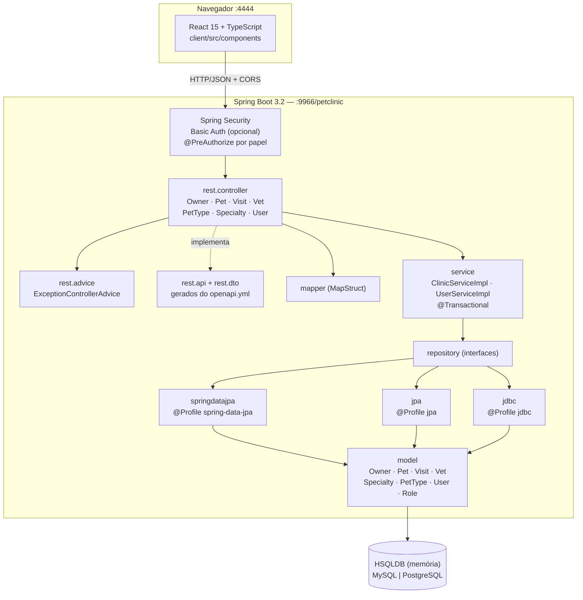
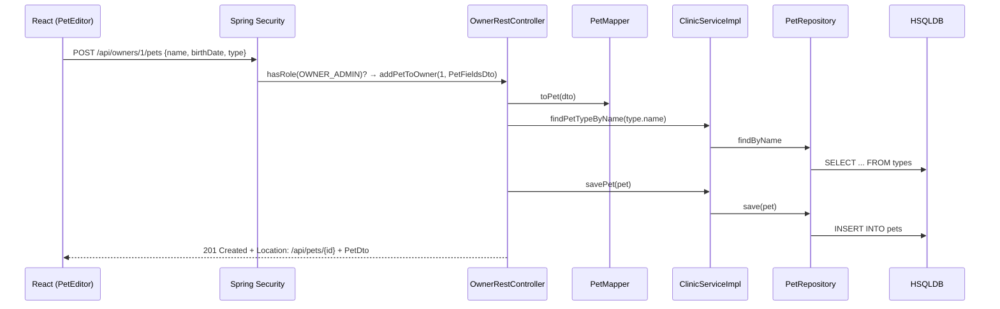

# 1. Documentação da Arquitetura — Spring PetClinic (React)

**Sistema avaliado:** [spring-petclinic/spring-petclinic-reactjs](https://github.com/spring-petclinic/spring-petclinic-reactjs)
**Licença:** Apache 2.0
**Backend:** Java 21 · Spring Boot 3.2.1 · Spring Data JPA / JPA / JDBC · Spring Security · MapStruct · OpenAPI Generator
**Frontend:** React 15 · TypeScript 2 · Webpack · Jest
**Banco de dados:** HSQLDB em memória (padrão), MySQL ou PostgreSQL via perfis Spring

## 1.1 Visão geral

O sistema é um porte do clássico *Spring PetClinic* para uma arquitetura **SPA + API REST**. O backend expõe uma API REST (`/petclinic/api/**`) descrita por um contrato OpenAPI (`src/main/resources/openapi.yml`). As interfaces dos controllers e os DTOs são **gerados em tempo de build** a partir desse contrato, e os controllers escritos pelos desenvolvedores implementam essas interfaces. O frontend React consome a API por `fetch`.

```
                     ┌──────────────────────────────────────────────────────────────────┐
                     │                     Navegador (porta 4444)                       │
                     │   React 15 + TypeScript  (client/src/components/**)              │
                     │   OwnerEditor · PetEditor · VisitsPage · VetsPage · FindOwners   │
                     └───────────────────────────────┬──────────────────────────────────┘
                                                     │ HTTP/JSON (fetch, CORS)
                                                     ▼
┌────────────────────────────────────────────────────────────────────────────────────────┐
│                 Spring Boot 3.2 — http://localhost:9966/petclinic                      │
│                                                                                        │
│  ┌───────────────┐   ┌────────────────────────┐   ┌───────────────────────────────┐    │
│  │ Spring        │   │ rest.controller        │   │ rest.advice                   │    │
│  │ Security      │──▶│ OwnerRestController    │   │ ExceptionControllerAdvice     │    │
│  │ (Basic/opc.)  │   │ PetRestController      │   │ (400 + BindingErrorsResponse) │    │
│  │ @PreAuthorize │   │ VisitRestController    │   └───────────────────────────────┘    │
│  └───────────────┘   │ VetRestController      │                                        │
│                      │ PetTypeRestController  │   ┌───────────────────────────────┐    │
│                      │ SpecialtyRestController│──▶│ mapper (MapStruct)            │    │
│                      │ UserRestController     │   │ OwnerMapper · PetMapper ...   │    │
│                      └───────────┬────────────┘   └───────────────────────────────┘    │
│                                  │                                                     │
│                      ┌───────────▼────────────┐   ┌───────────────────────────────┐    │
│                      │ service                │   │ rest.api / rest.dto           │    │
│                      │ ClinicServiceImpl      │   │ (GERADOS do openapi.yml)      │    │
│                      │ UserServiceImpl        │   └───────────────────────────────┘    │
│                      │ (@Transactional)       │                                        │
│                      └───────────┬────────────┘                                        │
│                                  │  interfaces: OwnerRepository, PetRepository, ...    │
│          ┌───────────────────────┼─────────────────────────────┐                       │
│          ▼                       ▼                             ▼                       │
│  ┌───────────────┐     ┌──────────────────┐        ┌─────────────────────┐             │
│  │ repository.   │     │ repository.jpa   │        │ repository.jdbc     │             │
│  │ springdatajpa │     │ (EntityManager)  │        │ (JdbcTemplate)      │             │
│  │ @Profile      │     │ @Profile("jpa")  │        │ @Profile("jdbc")    │             │
│  │ ("spring-     │     └──────────────────┘        └─────────────────────┘             │
│  │  data-jpa")   │                                                                     │
│  └───────┬───────┘                                                                     │
│          │           model: Owner · Pet · Visit · Vet · Specialty · PetType · User     │
│          ▼                                                                             │
│  ┌──────────────────────────────────────────────────────────────────────────────┐      │
│  │  DataSource — perfil hsqldb (memória) | mysql | postgresql                   │      │
│  │  Schema + dados: src/main/resources/db/<perfil>/initDB.sql, populateDB.sql   │      │
│  └──────────────────────────────────────────────────────────────────────────────┘      │
└────────────────────────────────────────────────────────────────────────────────────────┘
```

Diagrama equivalente em Mermaid (renderizado pelo GitHub):



## 1.2 Componentes e responsabilidades

| Camada / pacote | Classes principais | Responsabilidade |
|---|---|---|
| `rest.controller` | `OwnerRestController`, `PetRestController`, `VisitRestController`, `VetRestController`, `PetTypeRestController`, `SpecialtyRestController`, `UserRestController`, `RootRestController` | Endpoints REST. Implementam as interfaces geradas (`OwnersApi`, `PetsApi`...). Autorização por `@PreAuthorize("hasRole(@roles.X)")`. Redirecionam `/` para o Swagger UI. |
| `rest.advice` | `ExceptionControllerAdvice` | Converte `MethodArgumentNotValidException` em 400 com header `errors` (JSON de `BindingErrorsResponse`); captura `Exception` genérica e devolve 400 com nome da classe e mensagem. |
| `rest.api`, `rest.dto` (gerados) | `OwnersApi`, `OwnerDto`, `OwnerFieldsDto`, `PetDto`, `VisitDto`... | Contrato OpenAPI → interfaces e DTOs com validação Bean Validation (`@Size`, `@Pattern`, `@NotNull`). Gerados em `target/generated-sources/openapi`. |
| `mapper` | `OwnerMapper`, `PetMapper`, `VisitMapper`, `VetMapper`, `SpecialtyMapper`, `PetTypeMapper`, `UserMapper` | Conversão entidade ⇄ DTO via MapStruct (implementações geradas em compile-time). |
| `service` | `ClinicService`/`ClinicServiceImpl`, `UserService`/`UserServiceImpl` | Fachada transacional. `findXById` converte "não encontrado" em `null`. `UserServiceImpl` normaliza prefixo `ROLE_` e exige ao menos um papel. |
| `repository` | `OwnerRepository`, `PetRepository`, `VisitRepository`, `VetRepository`, `PetTypeRepository`, `SpecialtyRepository`, `UserRepository` | Interfaces de acesso a dados, com três implementações alternáveis por perfil Spring. |
| `repository.springdatajpa` | `SpringDataOwnerRepository`... | Implementação padrão (perfil `spring-data-jpa`). |
| `repository.jpa` | `JpaOwnerRepositoryImpl`... | Implementação com `EntityManager` (perfil `jpa`). |
| `repository.jdbc` | `JdbcOwnerRepositoryImpl`... | Implementação com `NamedParameterJdbcTemplate` (perfil `jdbc`). Cascata de exclusão feita manualmente. |
| `model` | `BaseEntity`, `NamedEntity`, `Person`, `Owner`, `Pet`, `Visit`, `Vet`, `Specialty`, `PetType`, `User`, `Role` | Entidades JPA com Bean Validation (`@NotEmpty`, `@Digits`). `Owner.getPets()` e `Pet.getVisits()` devolvem listas ordenadas e imutáveis. |
| `security` | `WebSecurityConfig`, `BasicAuthenticationConfig`, `DisableSecurityConfig`, `Roles` | Cadeia de filtros: por padrão (`petclinic.security.enable=false`) tudo é `permitAll`; com `true`, HTTP Basic + autenticação JDBC nas tabelas `users`/`roles`. CSRF desabilitado. CORS restrito a `http://localhost:4444`. |
| `util` | `EntityUtils`, `CallMonitoringAspect` | Busca por id em coleções; aspecto JMX que conta e cronometra chamadas de repositórios. |
| `config` | `SwaggerConfig` | Metadados do OpenAPI/Swagger UI. |
| `client/src` | `OwnerEditor`, `PetEditor`, `VisitsPage`, `VetsPage`, `FindOwnersPage`, `form/Constraints` | SPA React: formulários com validação client-side (`NotEmpty`, `Digits`) e chamadas `fetch` ao backend (`util/index.tsx`). |

## 1.3 Modelo de dados

Entidades e relacionamentos (ver também `petclinic-ermodel.png` na raiz do projeto):

```mermaid
erDiagram
    OWNERS ||--o{ PETS : "possui"
    TYPES ||--o{ PETS : "classifica"
    PETS ||--o{ VISITS : "recebe"
    VETS }o--o{ SPECIALTIES : "vet_specialties"
    USERS ||--o{ ROLES : "tem"

    OWNERS { int id PK; string first_name; string last_name; string address; string city; string telephone }
    PETS { int id PK; string name; date birth_date; int type_id FK; int owner_id FK }
    VISITS { int id PK; int pet_id FK; date visit_date; string description }
    TYPES { int id PK; string name }
    VETS { int id PK; string first_name; string last_name }
    SPECIALTIES { int id PK; string name }
    USERS { string username PK; string password; bool enabled }
    ROLES { int id PK; string username FK; string role }
```

Dados iniciais (`populateDB.sql`): 10 proprietários, 13 pets, 4 visitas, 6 veterinários, 3 especialidades, 6 tipos de pet, 1 usuário `admin` (senha `{noop}admin`) com os papéis `ROLE_OWNER_ADMIN`, `ROLE_VET_ADMIN` e `ROLE_ADMIN`.

## 1.4 Endpoints da API REST

| Recurso | Métodos | Papel exigido (quando segurança ativa) |
|---|---|---|
| `/api/owners`, `/api/owners/{id}` | GET (lista, filtro `lastName`), POST, PUT, DELETE | `OWNER_ADMIN` |
| `/api/owners/{id}/pets`, `/api/owners/{id}/pets/{petId}` | POST, GET | `OWNER_ADMIN` |
| `/api/owners/{id}/pets/{petId}/visits` | POST | `OWNER_ADMIN` |
| `/api/pets`, `/api/pets/{id}` | GET, POST, PUT, DELETE | `OWNER_ADMIN` |
| `/api/visits`, `/api/visits/{id}` | GET, POST, PUT, DELETE | `OWNER_ADMIN` |
| `/api/pettypes`, `/api/pettypes/{id}` | GET (OWNER_ADMIN ou VET_ADMIN), POST/PUT/DELETE | `VET_ADMIN` |
| `/api/vets`, `/api/vets/{id}` | GET, POST, PUT, DELETE | `VET_ADMIN` |
| `/api/specialties`, `/api/specialties/{id}` | GET, POST, PUT, DELETE | `VET_ADMIN` |
| `/api/users` | POST | `ADMIN` |
| `/`, `/swagger-ui/index.html`, `/v3/api-docs` | GET | público |
| `/actuator/**` | GET | público (health, info...) |

## 1.5 Fluxo de uma requisição (exemplo: cadastrar pet para um proprietário)



Observação relevante para os testes: o controller **não verifica** se o `ownerId` existe antes de salvar o pet (cria um `Owner` apenas com o id). A integridade depende da chave estrangeira do banco, e a violação resultante é capturada pelo `ExceptionControllerAdvice` genérico (400 com detalhes internos). Isso está registrado como risco e caso de teste.

## 1.6 Build, execução e ferramentas de qualidade já presentes

| Item | Como |
|---|---|
| Build + testes + cobertura | `./mvnw verify` (JaCoCo `prepare-agent` → `report` → `check` com mínimo de 85 % de linhas e 66 % de branches) |
| Executar | `./mvnw spring-boot:run` → `http://localhost:9966/petclinic/` (redireciona para o Swagger UI) |
| Trocar banco / camada de dados | `spring.profiles.active=hsqldb|mysql|postgresql , spring-data-jpa|jpa|jdbc` em `application.properties` |
| Ativar autenticação | `petclinic.security.enable=true` (usuário `admin` / senha `admin`) |
| Frontend | `cd client && npm install && PORT=4444 npm start` |
| CI | `.github/workflows/maven-build.yml` (GitHub Actions, Maven) |
| Análise estática | `sonar-project.properties` (SonarQube) |
